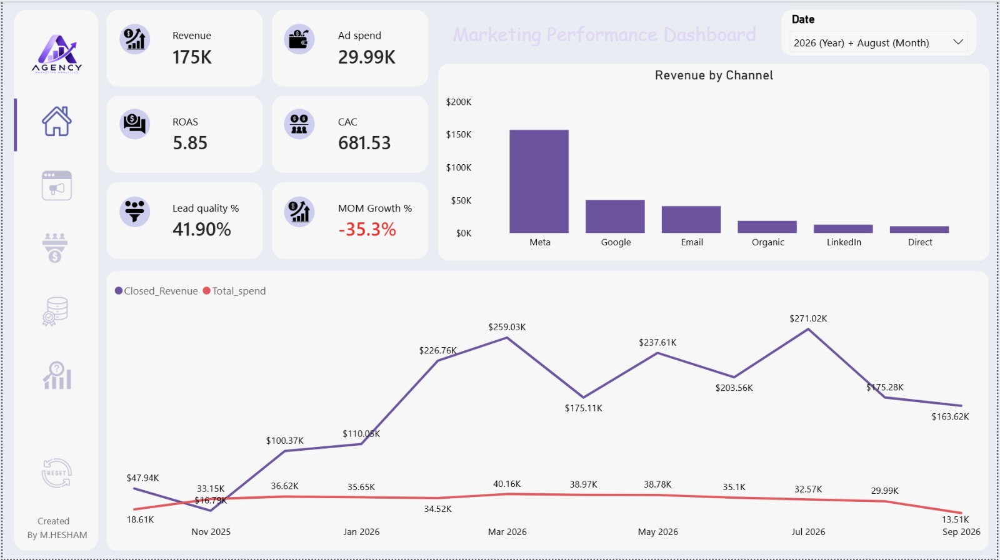

# Marketing Performance & Closed-Loop Analytics

### Turning Marketing Data into Measurable Business Outcomes

An end-to-end Marketing Analytics case study built using **Power BI**, designed to address the Closed-Loop Marketing problem by connecting advertising investments with leads, customer acquisition, deals, and actual revenue.

---

## 1. Project Overview

Marketing agencies often have access to extensive advertising data, including impressions, clicks, conversions, and lead generation metrics.

However, a major challenge arises when leads are transferred to the client's CRM system. The connection between the original marketing source, the resulting deal, and the actual revenue may become difficult to track.

This creates a visibility gap between marketing performance and actual business outcomes.

This project explores how data integration, modeling, and analytics can help bridge that gap and provide a more complete view of the customer journey.

**The main objective is to move beyond measuring leads and advertising performance toward measuring actual business impact.**

## 2. Business Problem

The central challenge is the lack of a clear connection between marketing investments and downstream business results.

Without proper tracking, decision-makers may struggle to answer questions such as:

- Which marketing channels generate actual customers rather than just leads?
- How much revenue is generated from advertising investments?
- Which campaigns contribute most to closed deals?
- What is the actual Customer Acquisition Cost (CAC)?
- How efficiently is the marketing budget being allocated?
- How can historical performance guide future marketing decisions?

### The Closed-Loop Journey

`Ad Spend → Leads → Opportunities → Customers → Closed Revenue`

The project aims to connect these stages and provide better visibility into the entire marketing-to-revenue journey.

## 3. Project Objectives

- Connect advertising performance with CRM and deal outcomes.
- Evaluate marketing channels based on actual revenue contribution.
- Analyze lead quality and conversion performance.
- Measure customer acquisition efficiency.
- Explore marketing attribution using First-Touch and Last-Touch models.
- Simulate budget reallocation scenarios.
- Evaluate marketing experiments and their outcomes.
- Support data-driven marketing decisions.

## 4. Tools & Technologies

| Tool | Purpose |
|---|---|
| Power BI | Dashboard development and visualization |
| Power Query | Data cleaning and transformation |
| DAX | Measures, KPIs, and analytical calculations |
| Data Modeling | Connecting advertising, leads, deals, and supporting tables |
| CSV | Source data |

## 5. Dashboard Structure

The dashboard consists of five analytical sections.

### 01. Executive Command Center

Provides a high-level overview of marketing performance through key business indicators, including:

- Revenue
- Advertising Spend
- ROAS
- CAC
- Lead Quality %
- Month-over-Month Growth



### 02. Channel & Campaign Performance

Evaluates marketing channels and campaigns based on their contribution to business performance.

Key analytical areas include:

- Revenue by Channel
- Advertising Spend
- Channel Performance Comparison
- Campaign Effectiveness


### 03. Funnel Health & Lead Quality

Focuses on the journey from lead generation to customer acquisition.

The analysis helps evaluate:

- Lead Quality
- Lead Conversion
- Funnel Performance
- Customer Acquisition


### 04. Data Quality & Reconciliation

Highlights the importance of data reliability when connecting marketing and CRM information.

This section focuses on data quality checks and reconciliation between different data sources to improve confidence in reported business metrics.


### 05. Forecast & Experiment Backlog

Introduces analytical capabilities that support future planning and marketing optimization.

Key components include:

- What-If Budget Reallocation
- Projected Leads
- Projected Customers
- Projected Revenue
- Marketing Experiment Tracking
- Experiment Results Analysis


## 6. Key Business Metrics

| KPI | Description |
|---|---|
| Revenue | Revenue generated from closed deals |
| Ad Spend | Total advertising investment |
| ROAS | Revenue generated relative to advertising spend |
| CAC | Average cost of acquiring a customer |
| Lead Quality % | Percentage of leads meeting qualification criteria |
| MoM Growth % | Revenue growth compared with the previous month |
| First-Touch Attribution | Revenue attributed to the first recorded marketing touchpoint |
| Last-Touch Attribution | Revenue attributed to the last recorded marketing touchpoint |

## 7. Analytical Approach

### Data Quality & Transformation
Reviewed and prepared the source datasets to support consistent analysis and reliable reporting.

### Data Modeling
Organized the data into a connected analytical model linking advertising activities, leads, touchpoints, deals, and supporting dimensions.

### Marketing Attribution
Implemented First-Touch and Last-Touch attribution logic to explore how different marketing channels contribute to customer acquisition and revenue.

### DAX & KPI Development
Created analytical measures to calculate business KPIs and evaluate performance across different dimensions and time periods.

### What-If Scenario Analysis
Developed a dynamic budget reallocation scenario to simulate changes in advertising investment between marketing channels and evaluate their potential impact on leads, customers, and revenue.

### Experiment Analysis
Analyzed marketing experiments based on their status and outcomes to support future optimization decisions.

## 8. Key Takeaways

This case study demonstrates why measuring marketing success solely through clicks, impressions, or lead volume can provide an incomplete picture.

Connecting marketing activities with CRM outcomes and closed revenue allows decision-makers to evaluate performance from a business perspective.

**The real value of marketing analytics is not simply measuring how much activity a campaign generates, but understanding how that activity contributes to business growth.**

## 9. Repository Structure

```text
Marketing-Performance-Closed-Loop-Analytics/
│
├── Image/
│   ├── Executive_Command_Center.png
│   ├── Channel&Campaign_Performance.png
│   ├── Funnel_Health&Lead_Quality.png
│   ├── Data_Quality&Reconciliation.png
│   └── Forecast&Experiment_Backlog.png
│
├── csv/
│   └── Source Datasets
│
├── Dashboard_Closed_Loop.pbix
│
└── README.md
```

## 10. Project Files

The repository includes:

- Power BI dashboard file (`.pbix`).
- Source datasets (`.csv`).
- Dashboard screenshots.
- Project documentation.

---

**Project Focus:** Marketing Analytics | Business Intelligence | Data Modeling | Marketing Attribution | Scenario Analysis

**Developed using:** Microsoft Power BI
